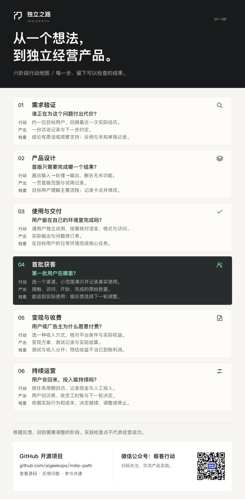

# 独立之路 · Indie Path

**借助 AI，把已有经验变成产品，向自己的盈利目标前进。**

      

讲怎么判断一个想法有没有人真的需要，讲怎么把首版裁到只剩一条能验证价值的主流程。讲需求访谈怎么问才问得出真实经历，讲落地页、定价实验、试用转化各自要留下什么证据。讲网页、手机应用、微信小程序、微信小游戏、手机游戏分别要过哪些平台关口。讲第一批用户从哪个渠道来，自媒体内容怎么和使用、付费对上号。讲收多少钱、怎么收、收到之后怎么记账，也讲公司主体、注册地、收款、对账和财税这些绕不开的事。

不讲课。每条任务写明投入多久、要交出什么、按什么标准算完成；引用的资料给出原始链接、选读范围和真实核验日期。

[在线站点](https://aigeekops.github.io/indie-path/) · [项目仓库](https://github.com/aigeekops/indie-path) · [下载行动地图 PNG](assets/action-map.png)

**不用全做。** 这是一份可查的备选单，不是必须从头走到尾的课表。挑走跟当前卡点相关的几条就算数，剩下的放着，需要时再回来查。做完自检也不代表市场验证、职业认证或经营成功。

---

## 你能得到什么

| 得到什么 | 具体是什么 | 在哪 |
|---|---|---|
| 一条按你的情况生成的路线 | 回答四组问题（走到哪了、能独立完成什么、目标与投入、产品形态与首发平台），即时看到推荐顺序和**每一条的推荐原因** | `#/profile` → `#/route` |
| 25 项必修主干 | 一条从「已有经验」走到「第一笔收入」的最小闭环，做完才算走通；其余 32 项是按需查阅的参考 | `#/library` |
| 可直接复制的起步包 | 25 项必修任务全部附四件套：可运行起点（照着填就能做）、AI 提示词包（按轮次给，可一键复制）、成品样例（做成之后长什么样，含不合格对照）、AI 边界（哪些判断不能交给 AI） | 任务内「起步包」 |
| 57 项可交付的实践任务 | 每项固定为「为什么做 → 开始条件 → 学习要点 → 按顺序做 → 交成果 → 完成判断」，并标注投入时长（多数 2–8 小时） | `#/library` |
| 一份能带走的成果模板 | 访谈原话记录、范围裁剪表、落地页文案、定价实验记录、渠道接触计划、复盘表——填的是真实数字和原话，不是感想 | 各任务内「交成果」 |
| 一次不含糊的验收 | 逐项确认后保存自检；未通过逐项自检不能记录完成。草稿可带入成果说明，改完成标准会触发原成果复核 | 各任务内「完成判断」 |
| 一个允许停下来的决定机制 | 完成后选择继续推进、调整后再验证、等待真实反馈、或**停止本轮投入**。停止是合法结果，系统不会自动推荐扩大开发 | `#/route` |
| 六阶段共用主线 | 需求验证 → 产品设计 → 使用与交付 → 首批获客 → 变现与收费 → 持续运营，任何形态都走同一条骨架 | `#/map` |
| 五种产品形态的专项关口 | 手机应用、微信小程序、微信小游戏、手机游戏共 18 项中文专项；网页产品走共用主线 | `#/profile` 第一步 |
| 9 个按需经营专题 | 公司选择、国内与中国香港注册、收款、对账、财税——需要时才展开，不占主线必修 | `#/topics` |
| 186 份可核验的资料 | 每份含原始链接、选读范围、阅读终点、真实核验日期。写清核验到哪一步，不把「入口能打开」写成「流程已验证」 | `#/sources` |
| 一份只存在本机的记录 | 个人情况、行动草稿、学习记录、反馈决定、经营收支全部存在当前浏览器 localStorage。无账号、无后端、不跨设备同步、不连接平台账号 | 本地 |

---

## 你现在卡在哪

找一行对上号，直接打开，填模板、存草稿，再根据真实反馈决定下一步。

| 你现在的情况 | 先做什么 | 打开后拿到什么 |
|---|---|---|
| 不知道做什么 | 找一位能接触的人，了解最近一次实际经历 | 问题访谈模板，`#/start/find` |
| 有个想法，不确定值不值得做 | 约一次 15 分钟访谈，追问最近一次任务、现有工具、代价、谁付款，并记一条反例 | 一页带日期的原话记录，`#/task/find` |
| 正在开发，功能越做越多 | 留下一条能验证价值的主流程，裁掉无关功能 | 首版范围裁剪表，`#/start/scope` |
| 已经上线没人用 | 选一个渠道，接触目标用户并观察使用 | 首批用户接触计划，`#/start/reach` |
| 有人用但没人付费 | 做一次定价实验，记录报价、拒绝原因和实际到账 | 定价实验记录，`#/task/price` |
| 不知道该不该继续 | 逐项自检后，明确记录继续、调整、等待或停止 | 反馈决定，`#/route` |
| 想知道这个月到底赚没赚 | 记收入、全部现金支出、工时和依据，按同币种逐月核对 | 经营核算，`#/route/profit` |
| 想做 App / 小程序 / 小游戏，不知道要过哪些关 | 先选产品形态，再按平台核对资格与提审条件 | 平台专项任务，`#/profile` |
| 不确定备案、资质、收款这些事自己能不能办 | 逐个平台查清主体与证件要求，找出一项你现在做不到的 | 国内资格门槛对照表，`#/start/cn-gates` |
| 要开发票、要注册公司、要过税 | 按需打开对应专题，不占主线 | 9 个经营专题，`#/topics` |

例如选「已经上线没人用」：先填渠道和目标对象，保存一份接触计划；做一次真实演示后，补上访问、开始、完成的原始数量与反馈；进入完整任务逐项核对验收，再决定下一轮改什么。未发生的使用与付费留空，保存草稿不计为完成任务。

---

## 六阶段

阶段归类是整理用的，不限制推荐顺序——报价可以提前验证，获客也可以早于交付。

| 阶段 | 要解决什么 | 做完手上有什么 | 任务数 |
|---|---|---|---|
| 需求验证 | 这个想法有没有人真的为它花过时间或钱 | 带日期的访谈原话、付款人、反例、下一步承诺 | 7 |
| 产品设计 | 首版留什么、砍什么，交互能不能走通 | 范围裁剪表、可点原型、可用性问题清单 | 7 |
| 使用与交付 | 真实用户能不能从头用到尾 | 上线主流程、性能指标、支持与留存的真实数据 | 21 |
| 首批获客 | 第一批用户从哪个渠道来 | 渠道接触计划、内容发布与复盘记录 | 7 |
| 变现与收费 | 收多少、怎么收、钱有没有真的到账 | 定价实验记录、收款链路核对、真实订单 | 7 |
| 持续运营 | 这个月值不值得继续投入 | 月度收入、现金支出、工时与决定依据 | 7 |

---

## 25 项必修主干，32 项按需参考

任务分两级。**必修**是一整条最小闭环：从确认有人真的需要，做到有人真的付钱，再决定要不要继续。这 25 项做完，你就完整走过一遍独立开发；跳任何一项，闭环都是断的。**参考**是卡住时才查的加深项，不必预先学——包括平台专项（App / 小程序 / 小游戏共 18 项）和进阶实验（接口契约、权限、留存、套餐设计等 14 项）。

选了具体产品形态后，平台专项会顶替必修中被替代的通用交付项进入你的路线，并标为「专项」——它同样必须走完。

| 阶段 | 必修（25 项） |
|---|---|
| 需求验证 | 找到一个值得继续验证的问题 → 选定第一组可接触的用户 → 检查你已有的需求证据 → 用低成本实验验证关键假设 → 回访实际用户，查清未付费原因 |
| 产品设计 | **核对国内上线与收款的资格门槛** → 确定首版范围 → 写清产品为谁解决什么问题 → 做一页能解释价值的落地页 |
| 使用与交付 | 看懂页面、请求与服务端 → 完成一次小程序、调试与变式 → 完成一个可以操作的界面 → 接入 AI 并算清每次有效使用的成本 → 建立一组 AI 输出评估样本 → 用证据验收核心流程 → 观察用户独立完成核心任务 → 上线一个别人能用的版本 |
| 首批获客 | 接触首批用户，追踪到实际使用 → 用自媒体内容带来第一批实际用户 |
| 变现与收费 | 在扩大开发前验证一种报价 → 验证报价，完成收费与交付 |
| 持续运营 | 建立支持入口，处理一次反馈 → 观察再次使用，核算经营投入 → 复盘自媒体带来的使用、付费与投入 → 用用户反馈决定下一项功能 |

在 `#/library` 里可以用「必修 / 参考」筛选，每项任务标题旁也有分级标记。新增任务默认是参考项，纳入必修需要在 Markdown 头部显式写 `track: core`，构建会校验总数。

25 项必修已全部补齐起步包四件套，每个任务页都能直接复制可运行起点与提示词包。构建统计里同步显示覆盖进度（当前 25 / 25）。

---

## 一张行动地图



`#/map` 与 `#/route` 共用六阶段、任务集合与验收状态。地图显示当前推荐、阶段自检数量和反馈决定；点击阶段或任务只原位切换预览，明确点击"开始学习"后在地图工作区完成学习与验收。返回预览保留所选阶段、任务和本次浏览位置，已完成任务可回看成果。同源浏览器标签页保存后自动同步；刷新后仍保留本地记录。未填写个人情况时展示公共任务目录。

下载地图图片是公共概览，不包含个人信息或实时进度。[PNG 图片](assets/action-map.png)适合保存与分享，[SVG 矢量版](assets/action-map.svg)适合放大查看。

---

## 按产品形态走到实际交付

在「规划我的路线」第一步选择产品形态，再选择首发平台与业务数据方式。市场未定可以留空；App Store 不等于出海，国内安卓也不等于所有商店使用同一套规则。

| 产品形态 | 专项实践 |
|---|---|
| 网页产品 | 走六阶段共用主线，不额外分叉 |
| 手机应用 | 平台与首版方案 → 原型 → 按需云端 → 变现接入 → 真机内测 → 提审 → 商店获客 → 运营 |
| 微信小程序 | 主体与类目 → 页面与数据 → 按需云端 → 交易或广告 → 测试提审 → 场景获客 → 运营 |
| 微信小游戏 | 游戏类目与玩法循环 → 可玩原型 → 按需云端 → 广告或虚拟支付 → 游玩与真机测试 → 微信提审及运营 |
| 手机游戏 | 平台与游戏发行条件 → 玩法循环与原型 → 按需云端 → 变现 → 游戏与平台测试 → 商店提审及运营 |

自媒体运营贯穿两阶段：在首批获客后做"用自媒体内容带来第一批实际用户"（content-plan），在产品经营复盘前做"复盘自媒体带来的使用、付费与投入"（content-review）。网页与应用产品共用这两项；国内优先展示微信/小红书选读，出海优先展示 X/YouTube 选读，每轮按受众选择一个主渠道。内容编号关联匿名使用记录和订单，观看、咨询、实际使用与付费分别记录。只用本浏览器保存，不连接平台账号或自动发布。

应用商店覆盖 App Store、国内安卓商店和 Google Play；国内以小米与华为 Android 文档为具体示例，其他商店单独核对。当前不包含原生鸿蒙、PC/Steam 游戏专项。只需本地业务数据的产品不强制自建账号或后端；支付、广告等第三方服务仍核对真实数据行为。

---

## 资料怎么核

全部资料集中在 [content/sources](content/sources/)，也可以在站内的 `#/sources` 页面逐条查看。每份文件写明原始链接、选读范围、阅读终点和真实核验日期。

几条硬规则：

- 选读以免费官方教材、平台文档和引擎教程为主，明确版本、核验范围与适用条件。
- 平台文档不计作完整课程。
- 无法直接读取的文档标明证据边界，不把"入口能访问"写成"全部后台流程已验证"。
- 官方 SDK 与旧培训材料只支持其已读取范围，不能证明某个 AppID 已有资格。
- 免费指公开文章/讲座，不包含证书、工具订阅、托管或支付服务费用。
- 账号、设备、云服务和平台交易费用单列，测试订单或广告预估不计作已到账利润。
- 更新时间不代表政策重新核验。

两个教学案例（国内与出海各一例）作为主动查阅的参考，人物、访谈、价格、订单和经营数字均为模拟，不是真实成功案例。

链接是否还活着由机器每周核一次：CI 每周一全量探测 186 份资料的入口，改动 `content/sources/` 的 PR 只探测本次变更的部分，结果写进工作流的作业摘要。超过 180 天没重新核验的资料会单独列出。它只回答"入口还开不开"，不回答"政策有没有变"——政策口径仍需按上面的规则人工核对。本地可用 `npm run sources` 复跑，加 `--strict` 才会因失效或过期而失败。

---

## 这不承诺什么

- 不承诺流量、收入或经营成功。它给的是行动方法和验收标准，不是结果。
- 完成自检不等于市场验证、职业认证或审计结论。经营核算只是自填现金结余的比较，不是交易核验。
- 资料可能过时，政策各地执行不一样。真去注册、报税、提审、收款时，以平台规则和当地部门的说法为准。
- 不要求账号，也没有后端：个人记录只存在当前浏览器。站点用无 Cookie 的 Umami Cloud 统计页面访问量，不识别具体使用者；不连接任何平台账号，也不自动发布。清空浏览器数据会一并清掉本地记录，不提供云端恢复。
- 使用 AI 但能够判断与负责交付，也算独立完成。这里不考证书，也不发证书。

发现写错了、链接失效了、或者某条核验范围写大了，欢迎按 [贡献指南](CONTRIBUTING.md) 提 issue 或 PR。

---

## 怎么开始

1. 打开 [在线站点](https://aigeekops.github.io/indie-path/)，或用下面的命令在本地跑一份。
2. 点右上角「规划我的路线」，回答四组问题。没有想法也能开始，不知道产品形态可以留空。
3. 在路线上挑一条跟当前卡点最近的任务，学、做、交成果、逐项自检。做完再决定继续、调整、等待还是停止。

只想随便看看：`#/library` 是全部 57 项任务的单列目录，支持关键词搜索、六阶段筛选和必修 / 参考筛选，不需要先填个人情况。

---

## 本地运行

网站是原生 HTML/CSS/JavaScript，无后端、账户、支付或模型服务。浏览器运行时只加载一个第三方脚本——Umami Cloud 访问统计，其余无第三方依赖；构建使用锁定版本的 Markdown/YAML 解析器。需要 Node.js 24，通过 HTTP 预览，不直接双击 HTML。

```sh
npm ci
npm run dev
```

访问 `http://127.0.0.1:4173/`。个人情况、行动草稿、学习记录、反馈决定和经营收支只保存在当前浏览器 localStorage，不会跨设备自动同步。切换模拟用户有记录时会请求确认；修改情况保留原说明，验收条件变化后需要复核。

## 用 Markdown 维护内容

现有 57 项任务、六阶段摘要、两个案例及选读资料统一位于 `content/`。公司选择、国内与中国香港注册、收款、对账及财税以 9 个按需专题融入 `#/topics`，在对应任务内可直接进入，不增加主线必修项。

- 修改正文、步骤、模板与完成标准：编辑对应 Markdown。
- 原始资料与核验范围：编辑 `content/sources/`，正文按资料 ID 引用。
- 本地保存后，`npm run dev` 自动重新编译，刷新页面即可查看。
- PR 自动检查；人工审核合并到 `main` 后重新构建。
- 修改正文保留任务 ID；修改完成标准会触发原成果复核。更新时间不代表政策重新核验。

详细格式与新增内容步骤见 `content/` 目录下的源 Markdown；资料来源统一维护在 `content/sources/`。

## 检查与发布包

首次克隆先运行 `npm ci`。内容检查、测试和构建都会从 Markdown 生成数据；不要手工编辑 `generated/` 或 `dist/`。

```sh
npm run check
npm test
npm run build
python3 -m http.server 4173 --bind 127.0.0.1 --directory dist
```

`dist/` 只包含浏览器需要的 HTML、CSS、JS、二维码和 `.nojekyll`，不会发布文档、测试、工作流、历史截图或本地验收材料。它是生成目录，不提交到仓库。

## 目录

| 文件 | 作用 |
|---|---|
| `index.html` / `styles.css` / `app.js` | 静态页面、样式和交互 |
| `content/tasks/` / `content/variants/` | 任务、模板、验收标准与按能力选读的教材 |
| `content/stages/` / `content/cases/` | 六阶段摘要与教学案例 |
| `content/topics/` / `content/sources/` | 按需经营专题与原始资料核验记录 |
| `content/personas/` / `content/roles/` | 模拟示例用户与职业背景选项 |
| `data.js` / `curriculum.js` | 推荐逻辑与 Markdown 构建数据的读取 |
| `stages.js` / `journey.js` | 共用六阶段、任务归属与地图/路线派生状态 |
| `progress.js` / `growth-view.js` / `route-view.js` | 反馈驱动的推荐、个人目标和经营记录 |
| `business-learning.js` / `direct-learning.js` | 经营资源、实践与直接学习入口 |
| `market-content.js` / `market-view.js` | 市场条件选择与案例展示 |
| `content-view.js` | 经营专题、搜索、草稿与编辑入口 |
| `lesson-materials.js` / `learning-view.js` / `acceptance.js` | 材料选择、教材展示和验收 |
| `action-map.js` / `action-view.js` | 共用地图摘要、首页行动入口与模板工作区 |
| `assets/action-map.png` / `assets/action-map.svg` | 可分享的行动地图 |
| `assets/wechat-qr.jpg` | 维护者提供的公众号二维码 |
| `scripts/` / `tests/` | 发布包、基本检查和测试 |

## 内容与许可

原创代码、文字和教学练习采用 [MIT](LICENSE)。第三方学习材料、品牌和二维码的权利边界见 [NOTICE.md](NOTICE.md)。

当前覆盖网页产品、手机应用、微信小程序、微信小游戏和手机游戏；插件、桌面与原生鸿蒙专项尚未覆盖。完成自检不代表市场验证、职业认证或经营成功。

欢迎按 [CONTRIBUTING.md](CONTRIBUTING.md) 提交具体任务、资源或交互改进。

## 交流

有问题、想法，或发现哪条资料失效了，欢迎来聊。关注微信公众号 **极客行动**，交流 AI 工具、学习指南和独立产品实践；也可以直接在仓库提 issue。

所有学习内容无需关注即可访问。
